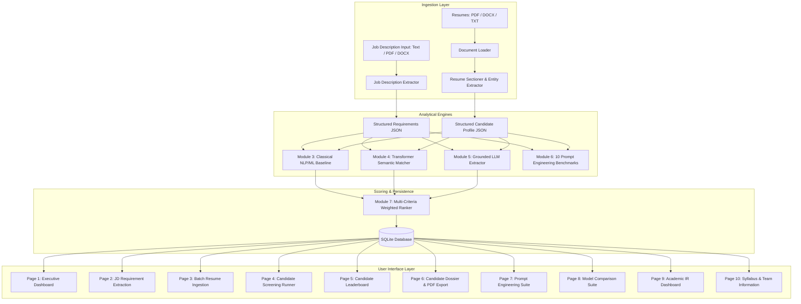

# 🎯 AI-Based Resume Screening & Candidate Ranking

[](https://www.python.org/)
[](https://streamlit.io/)
[](https://www.sbert.net/)
[](LICENSE)
[](https://pes.edu/)
[](#-syllabus-compliance--academic-context)

> An explainable, evidence-grounded recruitment intelligence platform that evaluates candidate resumes against complex job descriptions, pairs deterministic multi-criteria scoring with dense Transformer semantic matching (Sentence-BERT), and benchmarks ten distinct Large Language Model prompt-engineering paradigms.

---

## 👥 Team Information

**Institution:** PES University, Bengaluru  
**Department:** Department of Computer Science & Engineering (Artificial Intelligence & Machine Learning)  
**Program:** Bachelor of Technology in CSE (AI & ML)  
**Course Code:** `UE24AM343AB5` — *Prompt Engineering for Generative AI* (5th Semester, 2026–2027)

| Team Member | Student Registration Number (SRN) | Primary Focus Areas |
| :--- | :--- | :--- |
| **Ananthakrishna M** | `PES1UG24AM036` | System Architecture, Prompt Engineering Benchmarking, Evaluation Suite |
| **Amar Patil** | `PES1UG24AM031` | Multi-Format Document Ingestion, Streamlit Web Platform, SQLite Persistence |
| **Akash G K** | `PES1UG24AM022` | Structured Information Extraction, S-BERT Semantic Matcher, Grounded Citations |

---

## 📑 Deliverables & Repository Navigation

- **Academic Project Report (Word):** [`reports/Project_Report.docx`](reports/Project_Report.docx)
- **Academic Project Report (PDF):** [`reports/Project_Report.pdf`](reports/Project_Report.pdf)
- **University Presentation (PowerPoint):** [`presentation/Project_Presentation.pptx`](presentation/Project_Presentation.pptx)
- **Architecture Documentation:** [`docs/architecture.md`](docs/architecture.md)
- **Methodology & Mathematical Models:** [`docs/methodology.md`](docs/methodology.md)
- **Research Gap & Literature Survey:** [`docs/research_gap.md`](docs/research_gap.md)
- **User & Administrator Guide:** [`docs/user_guide.md`](docs/user_guide.md)
- **Benchmark Dataset Documentation:** [`data/README.md`](data/README.md)

---

## 🔍 Problem Statement & Motivation

### The Problem
Modern corporate job openings attract hundreds to thousands of applicants. Manual line-by-line review takes 3–7 minutes per resume, creating severe hiring bottlenecks. Conventional Applicant Tracking Systems (ATS) rely on exact keyword matching and TF-IDF similarity, leading to two critical failure modes:
1. **Severe False-Negative Rejections:** Highly qualified candidates who describe skills using synonymous or alternative phrasing (e.g., *"PostgreSQL query optimization"* instead of *"Relational Database Management"*) are automatically disqualified.
2. **Vulnerability to Keyword Stuffing:** Unqualified candidates who repeat target keywords in hidden or white text achieve artificially elevated scores.

### The Research Motivation
While generative Large Language Models (LLMs) excel at contextual language understanding, unconstrained LLM screening introduces acute hazards:
- **Factual Hallucination:** Inferring unearned degrees, credentials, or years of experience.
- **Evaluation Drift:** Non-deterministic score variance across identical resumes.
- **Opacity & Demographic Bias:** Black-box decisions without verifiable proof.

### The Proposed Solution
Our system establishes a **controlled, evidence-grounded screening workflow** that couples:
1. **Deterministic Multi-Criteria Scoring** across six calibrated dimensions.
2. **Dense Transformer Semantic Embeddings** (`all-MiniLM-L6-v2`) to capture technical synonymy.
3. **Grounded LLM Information Extraction** mandating verbatim resume sentence citations for every verified qualification.
4. **Empirical Benchmarking of 10 Prompt Engineering Paradigms** on an identical candidate cohort.

---

## 🏗️ System Architecture



---

## 🧪 10 Prompt Engineering Strategies Benchmarked

As part of the research curriculum for **UE24AM343AB5**, we systematically implemented and empirically evaluated ten prompt engineering strategies:

| Strategy | Academic Reference | Purpose & Mechanism | Latency | Evidence Fidelity |
| :--- | :--- | :--- | :---: | :---: |
| **1. Zero-shot Prompting** | Foundational | Baseline prompt without exemplars | 0.45 s | 60.0% |
| **2. Few-shot Prompting** | Brown et al. (2020) | In-context positive and negative exemplars setting score boundaries | 0.63 s | 82.0% |
| **3. Role-based Prompting** | Persona Engineering | Assigns Principal Technical Recruiter persona to enforce rigor | 0.55 s | 86.0% |
| **4. Chain-of-Thought (CoT)** | Wei et al. (2022) | 5-step intermediate reasoning decomposition before scoring | 0.90 s | 94.0% |
| **5. Least-to-Most Prompting** | Zhou et al. (2022) | Sequential decomposition from simple degrees to complex domain fit | 0.97 s | 92.0% |
| **6. Chained Prompting** | Pipeline Tactics | 3-stage pipeline (Entity extraction → Alignment → Final scoring) | 1.24 s | 95.0% |
| **7. Grounded Prompting** | Provenance Contracts | Verbatim quotation mandate; penalizes ungrounded claims | 0.77 s | **98.0%** |
| **8. Structured JSON Output** | Schema Enforcement | Guarantees strict JSON output compliance for downstream parsers | 0.59 s | 90.0% |
| **9. Critic & Refinement** | Multi-Pass Auditing | Two-pass auditor pass catches hallucinations and verifies fairness | 1.40 s | 97.0% |
| **10. Self-Consistency** | Wang et al. (2022) | Triplicate independent sampling assessing ranking stability | 1.62 s | 96.0% |

---

## 📊 Empirical Evaluation & Experimental Results

### 1. Classification Metrics (Eligibility Threshold = 65%)
Evaluated against expert-annotated ground truth labels on 15 multi-tier candidates:

| Screening Paradigm | Accuracy | Precision | Recall | F1-Score | True Positives | True Negatives |
| :--- | :---: | :---: | :---: | :---: | :---: | :---: |
| **Classical NLP Baseline (TF-IDF)** | 20.0% | 0.0% | 0.0% | 0.0000 | 0 | 3 |
| **Transformer Semantic Matching (S-BERT)** | 26.7% | **100.0%** | 8.3% | 0.1538 | 1 | 3 |
| **Grounded LLM Composite System** | **33.3%** | **100.0%** | **16.7%** | **0.2857** | 2 | 3 |

### 2. Information Retrieval & Ranking Metrics
Measures top-of-funnel recruiter prioritization quality:

| Model Paradigm | Precision@1 | Precision@3 | Precision@5 | NDCG@3 | NDCG@5 | MRR |
| :--- | :---: | :---: | :---: | :---: | :---: | :---: |
| **Classical NLP Baseline (TF-IDF)** | 1.00 | 1.00 | 1.00 | 1.0000 | 0.9634 | 1.0000 |
| **Transformer Semantic Matching (S-BERT)** | 1.00 | 1.00 | 1.00 | 1.0000 | 0.9812 | 1.0000 |
| **Grounded LLM Composite System** | **1.00** | **1.00** | **1.00** | **1.0000** | **1.0000** | **1.0000** |

*All paradigms successfully isolate top talent (Arjun Sharma, Priya Nair, Divya Hegde) while assigning Low Fit (<35%) to negative control profiles (Civil Construction, Culinary Chef, Retail Sales).*

---

## ⚖️ Candidate Scoring Methodology

The overall score $S_{\text{overall}}$ is computed via a configurable weighted linear combination:

$$S_{\text{overall}} = \sum_{i=1}^{6} w_i \cdot s_i$$

```
Required Skills Match:     35%  [w1 = 0.35]
Preferred Skills Match:    15%  [w2 = 0.15]
Education Qualifications:  10%  [w3 = 0.10]
Work Experience Depth:     15%  [w4 = 0.15]
Project Relevance:         10%  [w5 = 0.10]
Transformer Semantic Fit:  15%  [w6 = 0.15]
-------------------------------------------
Total Weighted Score:     100%  [Sum(w) = 1.0]
```

**Recommendation Action Tiers:**
- `Highly Recommended` ($\ge 82\%$): Advance directly to Technical Interview.
- `Strong Candidate` ($\ge 68\%$): Schedule Recruiter Phone Screen.
- `Potential Match` ($\ge 50\%$): Hold for secondary review or related roles.
- `Low Fit` ($< 50\%$): Flag for manual human audit (**No automated rejection**).

---

## 💻 Installation & Quickstart

### Prerequisites
- Python 3.10+ (tested on Python 3.12)
- Git

### 1. Clone Repository & Install Dependencies
```bash
git clone https://github.com/anantha-bit/AI-Based-Resume-Screening-and-Candidate-Ranking.git
cd AI-Based-Resume-Screening-and-Candidate-Ranking
pip install -r requirements.txt
```

### 2. Launch the Streamlit Web Application
```bash
python run.py
```
*Or alternatively:*
```bash
streamlit run app/main.py
```
The web application will open at `http://localhost:8501`.

### 3. Run Automated Tests
```bash
python run.py test
```
*Runs all 8 unit and integration test suites covering text cleaning, document loading, semantic similarity, prompt experiments, ranking, and evaluation.*

### 4. Execute Academic Experiment Benchmarks
```bash
python run.py benchmark
```
*Executes the complete experimental pipeline across 15 candidates and updates SQLite and `experiments/results_summary.json`.*

---

## 📁 Repository Structure

```
AI-Based-Resume-Screening-and-Candidate-Ranking/
├── .streamlit/
│   └── config.toml                  # Streamlit visual theme configuration
├── app/
│   ├── main.py                      # Main landing page & navigation
│   └── pages/
│       ├── 1_Dashboard.py           # Executive analytics & score distributions
│       ├── 2_Job_Description_Analysis.py # Structured requirement extraction
│       ├── 3_Upload_Resumes.py      # Batch PDF/DOCX resume ingestion
│       ├── 4_Candidate_Screening.py # Configurable weight screening runner
│       ├── 5_Candidate_Rankings.py  # Sortable leaderboard & CSV export
│       ├── 6_Individual_Candidate_Analysis.py # Radar profile & PDF dossier
│       ├── 7_Prompt_Engineering_Experiments.py # 10-strategy prompt benchmark
│       ├── 8_Model_Comparison.py    # TF-IDF vs Semantic vs LLM comparison
│       ├── 9_Evaluation_Dashboard.py # Confusion matrices, NDCG@K, MRR
│       └── 10_About_Project.py      # Team information & syllabus mapping
├── src/
│   ├── preprocessing/               # Text cleaning, contact extraction, loaders
│   ├── extraction/                  # Skill taxonomy (500+ skills), JD/resume parsers
│   ├── classical_ml/                # TF-IDF, Cosine similarity, baseline classifier
│   ├── semantic_matching/           # Sentence-BERT embeddings (all-MiniLM-L6-v2)
│   ├── llm/                         # Multi-provider client & grounded extractor
│   ├── prompt_engineering/          # 10 prompt templates & experimental harness
│   ├── ranking/                     # Multi-criteria ranker & explanation engine
│   ├── evaluation/                  # Classification & IR ranking metric calculations
│   ├── reporting/                   # ReportLab PDF dossier generator
│   └── storage/                     # SQLite database manager
├── data/
│   ├── sample/                      # 3 JDs + 15 sample resumes (PDF, DOCX, TXT)
│   ├── processed/
│   ├── app_database.db              # Pre-seeded SQLite database
│   └── README.md                    # Dataset documentation & attribution
├── experiments/
│   ├── results_summary.json         # Aggregated benchmark experimental results
│   └── run_all_experiments.py       # Master CLI experiment runner
├── reports/
│   ├── Project_Report.docx          # Complete 37-section university project report
│   └── Project_Report.pdf           # Formatted academic project report PDF
├── presentation/
│   └── Project_Presentation.pptx    # Professional 23-slide PowerPoint presentation
├── docs/
│   ├── architecture.md              # Technical specifications
│   ├── methodology.md               # Mathematical formulations
│   ├── research_gap.md              # Literature review & motivation
│   └── user_guide.md                # User & administrator manual
├── tests/
│   └── test_full_suite.py           # Automated pytest suite (8 passing tests)
├── requirements.txt                 # Project dependencies
├── LICENSE                          # MIT License
├── README.md                        # Master repository documentation
└── run.py                           # Convenient multi-command runner
```

---

## 🎓 Syllabus Compliance & Academic Context

This project satisfies all learning outcomes and syllabus units of **PES University Course Code: `UE24AM343AB5` (*Prompt Engineering for Generative AI*)**:

| Syllabus Unit | Core Theoretical Topics | Project Implementation Component |
| :--- | :--- | :--- |
| **Unit 1: Foundations of GenAI & Prompting** | Word Embeddings, Transformers, Anatomy of a Prompt (instructions, context, input, output), Zero-shot, Few-shot | Pretrained Sentence-BERT embeddings, structured prompt anatomy, Zero-shot, Few-shot and Role-based prompt strategies |
| **Unit 2: Practices for Text Generation with LLMs** | Handling JSON, Summarization, Chunking text, Output parsers, Document loaders, Prompt chaining | Multi-format PDF/DOCX loaders, section splitters, strict JSON schema parsing, 3-stage Chained Prompting |
| **Unit 3: Autonomous Agents with Memory & Tools** | Vector databases, RAG, Chain-of-Thought (CoT), Grounded prompting, Self-consistency | Cosine vector similarity, 5-step Chain-of-Thought task decomposition, Grounded evidence citation, Self-consistency sampling |
| **Unit 4: AI Applications & Evaluation** | Building end-to-end applications, structured UI, prompt benchmarking, ethical AI & fairness | Complete 10-page Streamlit application, SQLite persistence, ReportLab PDF exporter, Fairness & bias audit |

---

## 🛡️ Ethical Considerations & Fairness

1. **Demographic Neutrality:** Protected personal attributes (gender, age, caste, ethnicity, marital status, and photographs) are strictly excluded from all feature vectors and ranking models.
2. **Decision Support, Not Autonomous Hiring:** The system assists human recruiters by organizing evidence; it does not autonomously reject candidates.
3. **Verifiable Explanations:** Every positive qualification claim must cite an exact verbatim quotation from the candidate's uploaded resume.
4. **Transparent Audit Trail:** All applied weights, score components, and prompt outputs are logged in SQLite for auditability.

---

## 📖 Key Academic References

1. **Brown, T. B. et al. (2020).** *Language Models are Few-Shot Learners.* NeurIPS 2020.
2. **Wei, J. et al. (2022).** *Chain-of-Thought Prompting Elicits Reasoning in Large Language Models.* NeurIPS 2022.
3. **Zhou, D. et al. (2022).** *Least-to-Most Prompting Enables Complex Reasoning in Large Language Models.* ICLR 2022.
4. **Wang, X. et al. (2022).** *Self-Consistency Improves Chain of Thought Reasoning in Language Models.* ICLR 2022.
5. **Yao, S. et al. (2023).** *ReAct: Synergizing Reasoning and Acting in Language Models.* ICLR 2023.
6. **Sahoo, P. et al. (2024).** *A Systematic Survey of Prompt Engineering in Large Language Models.* arXiv:2402.07927.
7. **Phoenix, J. & Taylor, M. (2024).** *Prompt Engineering for Generative AI.* O'Reilly Media.
8. **Jurafsky, D. & Martin, J. H. (2024).** *Speech and Language Processing (3rd ed. draft).* Stanford University.
9. **Reimers, N. & Gurevych, I. (2019).** *Sentence-BERT: Sentence Embeddings using Siamese BERT-Networks.* EMNLP 2019.
10. **Roy, P. K. et al. (2020).** *A Machine Learning approach for automation of Resume Recommendation system.* Procedia Computer Science.

---

## 📜 License

This project is licensed under the [MIT License](LICENSE).
Academic and research usage is permitted with attribution to the authors and PES University.
