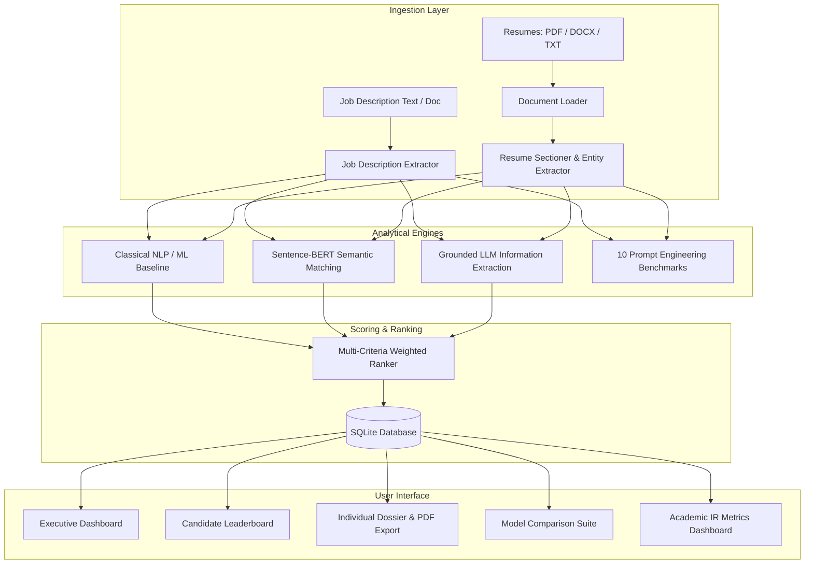

# System Architecture & Technical Specifications

## 1. System Overview
The **AI-Based Resume Screening & Candidate Ranking System** is an end-to-end recruiter-assistance platform designed to evaluate candidate resumes against complex job descriptions with high transparency, semantic awareness, and strict evidence grounding.

## 2. Core Functional Modules
1. **Document Ingestion (`src/preprocessing/document_loader.py`)**:
   - Parses `.pdf` via PyMuPDF.
   - Parses `.docx` via python-docx.
   - Parses `.txt` via UTF-8 normalizers.
   - Fault-tolerant design with error containment.

2. **Information Extraction (`src/extraction/`)**:
   - Skill taxonomy covering 500+ technical, cloud, AI, and soft skills with synonym mapping.
   - Section segmentation dividing documents into Education, Experience, Skills, Projects, and Certifications.
   - Pattern-based degree and experience timeline extraction.

3. **Classical Baseline Screener (`src/classical_ml/baseline_screener.py`)**:
   - N-gram (1,2) TF-IDF vectorization with sublinear term-frequency scaling.
   - Cosine similarity calculation.
   - Keyword Jaccard overlap, precision, and recall.
   - Trained logistic classifier assessing profile suitability.

4. **Transformer Semantic Screener (`src/semantic_matching/semantic_screener.py`)**:
   - Generates 384-dimensional dense semantic vectors using `all-MiniLM-L6-v2`.
   - Computes sectional embeddings (Skills, Experience, Projects).
   - Identifies semantic equivalence between different terminologies.

5. **Grounded LLM Extractor (`src/llm/llm_extractor.py`)**:
   - Extracts verbatim sentence evidence for each mandatory requirement.
   - Strictly outputs `"Not found in resume"` when information is absent.
   - Performs gap analysis and qualification synthesis.

6. **Prompt Engineering Suite (`src/prompt_engineering/`)**:
   - Implements 10 distinct prompt paradigms.
   - Benchmarks latency, valid JSON rate, extraction completeness, and consistency.

7. **Candidate Ranker (`src/ranking/ranker.py`)**:
   - Calibrates 6 weighted evaluation dimensions:
     - Required Skills Match: 35%
     - Preferred Skills Match: 15%
     - Education Qualifications: 10%
     - Work Experience Depth: 15%
     - Project Relevance: 10%
     - Semantic Similarity: 15%
   - Generates transparent recruiter explanations and assigns actionable tier badges.
